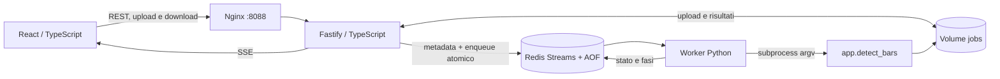

# Marker musicali per DaVinci Resolve

Il programma analizza un file audio ed esporta marker di un fotogramma in un file `.edl`, importabile nella timeline di Resolve. Può marcare ogni **tempo** oppure il primo tempo di ogni **misura**. I marker blu hanno evidenza concordante; quelli gialli, con suffisso `CHECK`, richiedono una verifica.

## Beat Studio: interfaccia web e job asincroni

L'applicazione completa include un frontend **React/TypeScript**, una REST API **TypeScript/Fastify**, un **worker Python** che esegue il rilevatore esistente e **Redis Streams** per la coda persistente. Ogni componente ha un container separato. Gli script CLI descritti nelle sezioni successive restano disponibili.

```bash
docker compose up --build -d
```

Aprire **http://localhost:8088**. La prima build installa anche PyTorch CPU e Beat This! e può richiedere diversi minuti. Il primo job Beat This!/ensemble scarica il checkpoint; il volume `checkpoints` lo conserva per gli avvii successivi.

1. Caricare un file MP3, WAV, FLAC, OGG, M4A, AAC, AIFF o OPUS, fino a 200 MB.
2. Scegliere madmom, Beat This! o ensemble, gli inizi di misura o tutti i beat, il metro e un eventuale suggerimento BPM.
3. Impostare i parametri avanzati se necessari: intervallo BPM, decoder DBN, qualità, affinamento, FPS, timecode, trim e offset.
4. Avviare il job. Il frontend riceve gli aggiornamenti via **SSE**, con polling di riserva se la connessione cade. La percentuale indica fasi di lavoro, non una previsione della durata.
5. Esplorare la forma d'onda con zoom e scorrimento, cliccare per spostare il cursore, selezionare i marker e ascoltare il PCM o l'audio con click. I marker verdi sono confermati; quelli gialli richiedono verifica. La timeline mostra `export_source_seconds`, le stesse posizioni quantizzate ai fotogrammi usate nell'EDL e nei click. Le aree esterne ai trim sono attenuate.
6. Scaricare il pacchetto ZIP o i singoli EDL, JSON, WAV e PNG. Il report conserva le informazioni originali del rilevatore; il ZIP include anche il log e i picchi della forma d'onda.

Le ultime 12 sessioni vengono memorizzate nel browser. Ricaricare la pagina recupera lo stato dell'ultimo job dal server, anche se l'analisi è ancora in corso. I file e i metadati persistono nei volumi Docker; non viene applicata una cancellazione automatica. Per ripetere un'analisi dopo un refresh occorre selezionare nuovamente il file locale.



Il detector viene eseguito come subprocess isolato per job all'interno del container worker. L'API non avvia Python e non attende il risultato nella richiesta di upload. Ogni job ha UUID, directory separata e stato `queued → running → completed/failed`. Il worker prepara i risultati in una directory temporanea e li pubblica solo a elaborazione completata. Upload e download grandi vengono trasferiti in streaming; i WAV supportano richieste HTTP Range per il seek audio.

Redis conserva metadati e messaggi con AOF (`appendfsync everysec`, con possibile perdita dell'ultimo secondo in caso di crash dell'host). I job in corso rimangono pending: lease rinnovabile di 60 secondi, heartbeat ogni 10 secondi e recupero tramite `XAUTOCLAIM` dopo 90 secondi di inattività. Un'interruzione ripete l'analisi dall'inizio, fino a 3 tentativi; un errore del detector o un timeout conclude il job come fallito e viene mostrato nel frontend. Ogni worker elabora un job alla volta; `docker compose up -d --scale worker=2` permette due analisi simultanee, con maggiore uso di CPU e memoria.

### Configurazione e gestione

Copiare `.env.example` in `.env` per modificare porta, indirizzo di ascolto, limite upload, timeout di analisi (default 1800 secondi) e durata massima audio (default 3600 secondi). Nginx accetta al massimo 1 GB per richiesta; il limite applicativo più restrittivo è controllato da `MAX_UPLOAD_MB`. Il limite della durata è verificato da FFprobe; l'estensione del file da sola non basta a renderlo un audio valido.

```bash
docker compose ps
docker compose logs -f api worker
docker compose stop                 # arresto; dati conservati
docker compose up -d                # riavvio
docker compose down                 # rimuove container e rete; dati conservati
```

Il servizio web è esposto su **127.0.0.1** per default. API, Redis e worker sono sulla rete interna Docker. È una configurazione locale/singolo utente: chi può raggiungere l'app può creare job e accedere a un job di cui conosce l'UUID. Per pubblicarla su Internet aggiungere autenticazione, autorizzazione dei job, TLS, quote e una politica di conservazione. Non usare `docker compose down -v` se si vogliono conservare risultati, coda e checkpoint.

### Contratto REST

| Metodo | Endpoint | Risposta |
| --- | --- | --- |
| GET | `/api/health` | Stato Redis e presenza di un worker |
| GET | `/api/config` | Algoritmi, default e limite upload in byte |
| POST | `/api/jobs` | Multipart: `audio` (file) e `config` (JSON), ordine libero; `202` con job e header Location |
| GET | `/api/jobs/:id` | Stato, fasi, impostazioni, eventuale errore |
| GET | `/api/jobs/:id/events` | SSE `event: job`, snapshot iniziale e aggiornamenti; chiude allo stato finale |
| GET | `/api/jobs/:id/result` | Report originale JSON schema 2, disponibile dopo il completamento |
| GET | `/api/jobs/:id/preview` | Durata e fino a 4000 coppie min/max del PCM |
| GET | `/api/jobs/:id/files/:artifact` | `zip`, `json`, `edl`, `clicks`, `pcm`, `debug`; supporto HTTP Range |

```bash
curl -F 'audio=@input/music.mp3' \
  -F 'config={"backend":"ensemble","markerType":"beats","fps":"25","beatsPerBar":"4"}' \
  http://localhost:8088/api/jobs
```

La definizione condivisa in `shared/config.ts` convalida sia il form sia l'API. Sono accettate solo opzioni note, CPU e checkpoint `final0`/`small0`: nessun percorso di output o comando arbitrario viene passato dal client. Valori non validi restituiscono `400`; upload troppo grandi `413`, estensioni non supportate `415`, job assenti `404`, risultati non pronti `409`. L'API limita gli upload a 10 richieste/minuto e le altre richieste a 120/minuto per indirizzo visto dall'API (nel Compose, il proxy Nginx); il flusso SSE è escluso dal limite.

### Sviluppo e verifiche

Richiede Node.js >= 22.12. Per lo sviluppo React e Fastify possono girare sul computer, mentre Redis e il worker rimangono containerizzati. Entrambi devono usare **la stessa directory dati**:

```bash
npm ci
npm run build
npm test

# Stack completo e verifica end-to-end con un brano ritmico:
docker compose up --build -d
python3 scripts/smoke-web.py input/music.mp3
python3 scripts/smoke-web.py input/music.mp3 --backend ensemble
# Verifica di recupero: riavvia il worker durante il proprio job (usare a stack inattivo):
python3 scripts/smoke-web.py input/music.mp3 --restart-worker

# Test Python del detector e del wrapper:
docker compose run --rm --no-deps -v "$PWD/tests:/app/tests:ro" --entrypoint python worker -m unittest discover -s tests -v
docker compose run --rm --no-deps --entrypoint python worker -m unittest worker.test_worker -v
```

Per hot reload, avviare un Redis esposto **solo in locale** e il worker con un bind mount della directory `.local-data`; impostare `REDIS_URL=redis://localhost:6388` e `DATA_DIR="$PWD/.local-data"` per `npm run dev:api`. Avviare poi `npm run dev:web` in un secondo terminale e aprire `http://localhost:5173`. Vite inoltra `/api` alla porta 3000. Il normale Compose non espone Redis; `compose.dev.yaml` usa un progetto separato per evitare che la coda locale elabori file dei volumi del normale stack:

```bash
mkdir -p .local-data/models
LOCAL_UID=$(id -u) LOCAL_GID=$(id -g) docker compose -p beat-studio-dev -f compose.yaml -f compose.dev.yaml up --build -d redis worker
REDIS_URL=redis://localhost:6388 DATA_DIR="$PWD/.local-data" npm run dev:api
# In un altro terminale:
npm run dev:web
```

### Pipeline GitHub e immagini GHCR

Il workflow `.github/workflows/ci.yml` esegue build TypeScript, test API e test Python prima di costruire e pubblicare tutte le immagini del progetto su **GitHub Container Registry**. Usa Buildx, cache GitHub Actions e immagini per **linux/amd64 e linux/arm64**.

- **Push su `main`**, inclusi i merge: avvia la pipeline se cambiano sorgenti, dipendenze, Dockerfile, script, test o workflow. Modifiche al solo README non avviano le build.
- **Push di qualsiasi tag Git**: avvia la pipeline anche senza nuovi cambiamenti ai sorgenti. Il tag deve contenere il workflow; creare soltanto un tag locale non avvia GitHub Actions.
- **Pull request verso `main`**: verifica test e build con gli stessi filtri sui file, senza login o pubblicazione nel registry.
- **Avvio manuale** dalla scheda Actions: pubblica soltanto se il riferimento selezionato è `main` oppure un tag; sugli altri branch verifica le build.

I nomi delle immagini sono ricavati automaticamente dal repository, in minuscolo:

| Immagine GHCR | Contenuto |
| --- | --- |
| `ghcr.io/<owner>/<repository>-web` | Frontend React servito da Nginx |
| `ghcr.io/<owner>/<repository>-api` | REST API Fastify |
| `ghcr.io/<owner>/<repository>-worker` | Worker Python con madmom e Beat This! |
| `ghcr.io/<owner>/<repository>-cli` | Rilevatore CLI con madmom |
| `ghcr.io/<owner>/<repository>-cli-full` | Rilevatore CLI con madmom e Beat This! |

Redis usa l'immagine ufficiale già presente nel Compose. Tutte le immagini pubblicate ricevono il tag `sha-<commit SHA completo>`. Le build di `main` aggiornano anche `main` e `latest`. Le release ricevono il tag Git (per esempio `v1.2.3`) e, per i tag SemVer, anche la versione `1.2.3`; non aggiornano `latest`. I tag Git non compatibili con i nomi Docker vengono normalizzati da `docker/metadata-action`.

Per avviare una release dopo aver salvato le modifiche nel repository:

```bash
git tag v1.2.3
git push origin v1.2.3
# Dopo il completamento del workflow, sostituire owner/repository:
docker pull ghcr.io/owner/repository-worker:v1.2.3
```

Il workflow usa `GITHUB_TOKEN` con `contents: read` e `packages: write` nel solo job delle immagini: non occorre configurare un PAT per la pubblicazione. GitHub Actions e la creazione dei package devono essere consentiti dalle impostazioni del repository/organizzazione. Per un package preesistente, verificare che il repository abbia accesso di scrittura. I package nuovi seguono la visibilità iniziale di GHCR; per scaricare immagini private occorre effettuare il login a `ghcr.io`. Per i dettagli vedere la [documentazione di GitHub Container Registry](https://docs.github.com/en/packages/working-with-a-github-packages-registry/working-with-the-container-registry).

## Avvio

Richiede Docker. Inserire il brano in `input/music.mp3`, poi:

```bash
./build.sh
./start.sh
```

Il motore predefinito è madmom. Gli output sono:

- `output/music.edl`: marker per Resolve.
- `output/music.json`: tempi originali, correzioni, punteggi, motivi di esclusione e configurazione.
- `output/music-debug.png`: forma d'onda, attacchi e qualità dei marker.
- `output/music-clicks.wav`: musica con click sulle posizioni **esportate**, arrotondate ai fotogrammi.

Gli script funzionano anche se avviati da un'altra cartella. `MUSIC_FILE` cambia il nome del file dentro `input`; `MUSIC_IMAGE` cambia l'immagine Docker. Le opzioni aggiunte a `start.sh` sostituiscono i valori predefiniti.

## Script per le diverse modalita

Gli avvii dedicati scelgono il motore e il tipo di marker e salvano i risultati in cartelle separate, permettendo di confrontare le modalita senza sovrascrivere gli altri risultati.

| Comando | Rilevazione | Cartella dei risultati |
| --- | --- | --- |
| `./start-ensemble-bars.sh` | Beat This! + madmom, inizi di misura; stessa analisi dell'ultimo test | `output/ensemble-bars/` |
| `./start-ensemble-beats.sh` | Beat This! + madmom, ogni tempo, incluse pulsazioni implicite | `output/ensemble-beats/` |
| `./start-ensemble-attacks.sh` | Beat This! + madmom, tempi con attacco confermato | `output/ensemble-attacks/` |
| `./start-ensemble-strict.sh` | Attacchi confermati, escludendo anche i marker da rivedere | `output/ensemble-strict/` |
| `./start-madmom.sh` | Solo madmom, inizi di misura | `output/madmom/` |
| `./start-beat-this.sh` | Solo Beat This!, inizi di misura | `output/beat-this/` |

Ogni cartella contiene JSON, EDL, grafico, audio con click e copia PCM WAV. Per `input/music.mp3`, per esempio, il primo script genera `output/ensemble-bars/music.edl`. Il nome base cambia con il file di input. Rilanciare la stessa modalita sullo stesso file aggiorna i suoi risultati; le cartelle delle altre modalita restano separate.

Gli script ensemble e Beat This! usano automaticamente l'immagine completa `music-bar-detector:robust`, gia disponibile nell'ambiente attuale. Per ricrearla o preparare un altro computer:

```bash
./build-full.sh
```

Lo script madmom usa l'immagine base creata da `./build.sh`. `MUSIC_IMAGE` permette di scegliere un tag diverso per ciascun avvio. `build-full.sh` crea l'immagine completa con un tag separato: ricostruire l'immagine base non elimina il motore Transformer.

Tutti gli script accettano le normali opzioni del rilevatore, dopo il comando:

```bash
# Ogni tempo con attacco confermato, timeline a 24 fps
./start-ensemble-attacks.sh --fps 24

# Inizi di misura in un 4/4 a circa 128 BPM
./start-ensemble-bars.sh --beats-per-bar 4 --bpm 128

# Riproduzione dell'ultimo test, con grafico limitato ai primi 12 secondi
./start-ensemble-bars.sh --debug-duration 12

# Un altro brano, con nome contenente spazi
MUSIC_FILE='altro brano.mp3' ./start-ensemble-beats.sh --fps 25
```

Il grafico predefinito mostra l'intero brano; `--debug-duration` limita soltanto il grafico. Gli FPS predefiniti sono 25 e l'origine della timeline e `01:00:00:00`, come in `start.sh`.

## Beat This! e confronto tra modelli

È disponibile anche [Beat This!](https://github.com/CPJKU/beat_this), il modello Transformer pubblicato a ISMIR 2024. Il codice e i pesi sono distribuiti dagli autori con licenza MIT. Per installare il motore opzionale:

```bash
WITH_BEAT_THIS=1 ./build.sh
BEAT_BACKEND=ensemble ./start.sh
```

`ensemble` mantiene la sequenza di Beat This! e controlla la concordanza con madmom. I disaccordi vengono segnalati; le sequenze non vengono unite e i tempi non vengono mediati automaticamente. Per usare soltanto il Transformer:

```bash
BEAT_BACKEND=beat-this ./start.sh
```

Il primo utilizzo scarica il checkpoint `final0` (circa 78 MB) dal server pubblico degli autori. I pesi vengono conservati in `models/torch`, montato dallo script: gli avvii successivi possono funzionare offline. Per ridurre il carico usare `--checkpoint small0`; per un checkpoint locale, salvarlo in `models` e passare `--checkpoint /models/nome.ckpt`. Il funzionamento standard usa la CPU; su un'installazione Python nativa si possono selezionare `--device mps` o `--device cuda`, se disponibili. Il Docker fornito installa PyTorch CPU.

Il modello alternativo non garantisce risultati migliori su ogni brano. Il confronto con annotazioni umane resta necessario per misurare la qualità.

In modalità ensemble, un attacco debole può essere confermato soltanto se entrambe le reti lo sostengono e la distanza temporale è molto piccola (al massimo 20 ms). La soglia effettiva di forza viene registrata in ogni evento del JSON. Questo limita lo scarto automatico dei colpi quieti senza autorizzare grandi spostamenti verso rumore o note vicine.

## Scelta dei marker

```bash
# Ogni tempo, anziché soltanto il primo di ogni misura
./start.sh --marker-type beats

# Solo tempi con un attacco sonoro confermato vicino alla previsione
./start.sh --marker-type beats --mode attacks

# Escludere anche i marker che richiedono revisione
BEAT_BACKEND=ensemble ./start.sh --marker-type beats --mode attacks --strict

# Inizi di misura in un 4/4 noto, con suggerimento di tempo
./start.sh --beats-per-bar 4 --bpm 128
```

`--mode grid` mantiene le pulsazioni implicite: un tempo musicale può esistere anche durante una pausa o una sincope. `--mode attacks` privilegia i punti udibili utili al montaggio, sacrificando alcuni tempi validi privi di un transitorio chiaro. `--strict` è ancora più selettivo e può lasciare vuoti: non crea marker sostitutivi.

`--min-confidence 0.65` stabilisce la soglia per la revisione. Il punteggio combina attivazione del modello, attacco, regolarità locale e controlli disponibili; **non è una probabilità calibrata**. I segnali ambigui possono richiedere revisione anche con un punteggio alto. La soglia comporta esclusione soltanto con `--strict`.

Il numero originale di misura/tempo rimane nel nome del marker quando altri marker vengono esclusi. La numerazione degli eventi EDL è indipendente.

## Analisi e limiti

1. L'audio viene decodificato una sola volta, mantenendo la stessa origine temporale per tutti i motori. Il PCM comune è mono a 44.1 kHz; le trasformazioni interne dei modelli mantengono i loro sample rate previsti. In caso di forte cancellazione di fase stereo viene usato il canale più energico, con avviso nel JSON.
2. Gli attacchi vengono analizzati a 22.05 kHz con hop di 128 campioni (circa 5.8 ms), usando mix completo, componente percussiva HPSS e basse frequenze. Un passaggio sull'energia cerca il fronte del transitorio entro una finestra limitata. Questa risoluzione non equivale a una garanzia di accuratezza.
3. Le posizioni del modello possono spostarsi al massimo di `--max-snap-ms 50`, e comunque non oltre il 10% del periodo locale. Attacchi deboli, alternativi di forza simile, incroci e discontinuità ritmiche non autorizzano uno spostamento arbitrario. `--no-refine` conserva i tempi originali per il confronto.
4. L'energia molto bassa, le attivazioni deboli, l'assenza di attacchi, le irregolarità e i disaccordi tra reti producono indicatori di revisione. `--silence-db -60` controlla il limite assoluto; è applicato anche un limite relativo di -45 dB rispetto al 95° percentile dell'energia del brano. Per musica molto quieta questa impostazione va verificata.
5. Un controllo librosa confronta la fase degli attacchi usando il tempo locale della rete. È una verifica guidata, non un secondo riconoscimento indipendente del metro. Il controllo gira in un processo separato: un errore nativo o un timeout lascia disponibili i risultati della rete e un avviso. `--no-librosa-check` lo disattiva. Numba usa CPU `generic` per evitare istruzioni ARM non supportate in alcuni ambienti Docker.

La DBN di madmom considera per default misure di 3 o 4 tempi e 40–240 BPM. `--beats-per-bar 3,4`, `--min-bpm`, `--max-bpm`, `--transition-lambda` e `--activation-threshold` permettono di controllarla. Valori maggiori di `transition-lambda` favoriscono un tempo stabile; musica dal vivo può richiedere valori minori. La selezione automatica 3/4 della DBN sceglie un metro per l'intero file: non riconosce automaticamente ogni cambio di metro.

Beat This! usa normalmente il suo decoder minimale, che può produrre numeri variabili di tempi tra gli inizi di misura. `--beat-this-dbn` usa invece la DBN configurata. Specificare un metro, un BPM, limiti BPM o parametri DBN personalizzati attiva la DBN anche per Beat This!, per non ignorare i vincoli. `--bpm` restringe l'intervallo a ±15%, nei limiti di `--min-bpm`/`--max-bpm`; non forza una griglia a BPM esattamente costante. I tempi prima del primo downbeat restano classificati come introduzione/anacrusi, senza inventare un inizio di misura.

HPSS è un'indicazione ausiliaria, non una separazione perfetta della batteria; `--no-percussive` la disattiva. Sincopi, rubato, introduzioni ambient, mezzi/doppi tempi e cambi di metro richiedono ancora verifica musicale. Nessun marker è garantito corretto dal colore o dal punteggio.

## Posizione della clip e timecode

Gli FPS devono corrispondere alla timeline. Sono supportati FPS interi e 23.976, 29.97, 59.94, anche come frazioni esatte. L'aritmetica somma **fotogrammi** al timecode di partenza, distinguendo la frequenza effettiva dai numeri delle etichette; non introduce lo scarto di circa 3.6 secondi all'ora presente nella precedente conversione NTSC.

```bash
# Audio collocato dieci secondi dopo l'origine della timeline,
# con i primi 5 secondi del file rimossi e un offset manuale di un frame
./start.sh --fps 25 --timeline-start 01:00:00:00 \
  --audio-start 01:00:10:00 --source-in 5 --offset-ms 40

# NTSC non-drop-frame
./start.sh --fps 24000/1001

# Drop-frame: ammesso soltanto a 29.97 e 59.94 FPS
./start.sh --fps 29.97 --drop-frame --timeline-start '01:00:00;00'
```

`--audio-start` è il timecode **assoluto di inizio della clip già rifilata**; per default coincide con l'origine della timeline. `--source-in` e `--source-out` sono posizioni in secondi nel file sorgente. L'analisi usa comunque l'intero file per conservare il contesto ritmico. Un offset positivo ritarda i marker. Eventi fuori dalla clip e duplicati nello stesso fotogramma vengono esclusi e registrati nel JSON.

L'arrotondamento al fotogramma più vicino avviene una sola volta: a 25 fps resta un errore inevitabile fino a circa 20 ms. Il JSON registra `quantization_error_ms` e la posizione effettiva `export_source_seconds`. Le funzioni non implementano retiming della clip, cambi di velocità o mappature temporali non lineari. L'importazione in Resolve va controllata sulla timeline reale, soprattutto per drop-frame e inizio clip.

## Diagnostica locale

```bash
./start.sh --debug-start 30 --debug-duration 10
```

Nel grafico le linee tratteggiate indicano le posizioni della rete, le linee colorate quelle affinate, il grigio gli eventi esclusi. Il click WAV mantiene i canali originali e usa le posizioni video esportate, comprese le correzioni manuali, e mantiene la durata del file sorgente; con `--source-in` i click restano nelle coordinate originali del file.

Per importare in Resolve lo stesso PCM usato come origine temporale dell’analisi, aggiungere `--pcm /output/music-pcm.wav` e utilizzare quel WAV nella timeline. La copia mantiene i canali originali, viene ricampionata a 44.1 kHz ed è salvata a 32 bit float. Può aiutare a distinguere eventuali differenze di decodifica MP3 dagli errori del rilevatore.

Il JSON schema 2 contiene `beats` (tutti gli eventi analizzati), `bars` (gli inizi di misura con durata) e `markers` (gli eventi esportati). Ogni evento conserva tempi originali e affinati, segnali di qualità e `export_status`. L'ultima misura viene segnalata come potenzialmente incompleta. Le durate si riferiscono al file sorgente, non alla clip rifilata. I campi timecode sono presenti sugli eventi effettivamente esportati.

## Misurare il miglioramento

Preparare un file TXT con una posizione annotata manualmente in **secondi del sorgente** per riga; sono ammessi commenti dopo `#`. In alternativa usare una lista JSON di numeri. I riferimenti devono indicare lo stesso tipo di evento scelto: tutti i tempi o solo inizi di misura.

```bash
docker run --rm -v "$(pwd):/workspace:ro" --workdir /workspace \
  --entrypoint python music-bar-detector \
  -m app.evaluate output/music.json input/reference-downbeats.txt \
  --kind downbeats --stage original --tolerance-ms 20

docker run --rm -v "$(pwd):/workspace:ro" --workdir /workspace \
  --entrypoint python music-bar-detector \
  -m app.evaluate output/music.json input/reference-downbeats.txt \
  --kind downbeats --stage refined --tolerance-ms 20
```

`--kind markers --stage exported` valuta invece i punti realmente esportati. In questo caso anche i riferimenti vengono limitati all'intervallo della clip. I marker esclusi da un filtro possono risultare tempi mancanti: è il compromesso tra precisione e copertura.

La valutazione abbina eventi uno a uno, massimizzando il numero di corrispondenze e poi minimizzando l'errore. Riporta precision, recall, F1, falsi positivi, tempi mancanti, errore medio, 95° percentile e anticipo/ritardo medio. Le statistiche temporali riguardano solo gli eventi abbinati: vanno lette insieme ai mancanti e ai falsi positivi. Usare più brani e anche tolleranze di 40 e 70 ms; 20 ms è una soglia severa per il montaggio a 25 fps.

## Test e installazione Python

```bash
docker run --rm -v "$(pwd):/workspace:ro" --workdir /workspace \
  --entrypoint python music-bar-detector -m unittest discover -s tests -v
```

I test coprono timecode frazionari/drop-frame, quantizzazione, trim/offset, duplicati, filtraggio, transienti sintetici, silenzi, stereo in opposizione di fase e metriche uno a uno. Non certificano l'accuratezza musicale su brani senza riferimenti umani.

Per un ambiente Python 3.11 separato con FFmpeg disponibile:

```bash
python -m pip install -r requirements.txt
python -m pip install 'git+https://github.com/imcmurray/madmom-modern.git@df718c704a3b460ac6c61b7e61663a0436b91bda'
# Facoltativo:
python -m pip install -r requirements-beat-this.txt
python -m app.detect_bars input/music.mp3 --output output/music.json --edl output/music.edl
```

Le dipendenze principali e la revisione di madmom sono fissate; le versioni effettive dei pacchetti vengono registrate nei risultati. Le dipendenze transitive e l'immagine base Docker non sono bloccate integralmente. `python -m app.detect_bars --help` mostra tutte le opzioni.
